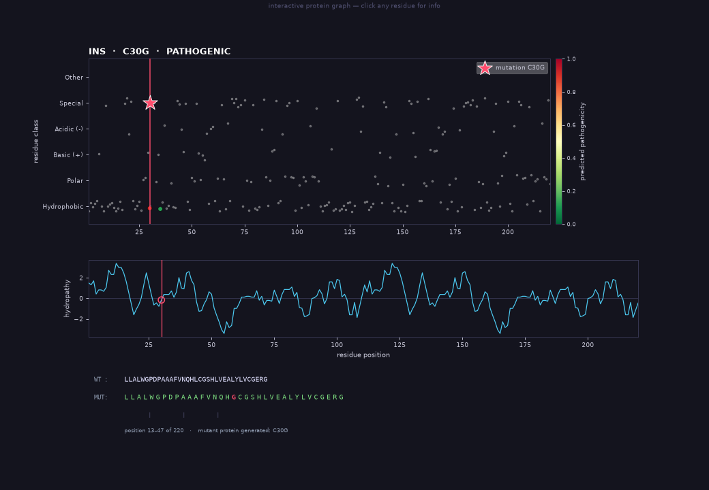

# DNA Mutation Effect Predictor

**Research-grade missense-variant triage with protein language models.**

[](LICENSE)
[](https://www.python.org/)
[](#disclaimer)

Predicts whether a human **missense** mutation is likely pathogenic or benign from
ESM-2 protein embeddings, with an optional population-signal model built from
gnomAD allele frequency, SIFT, and PolyPhen.

> **Not a medical device.** This project is for research and education only.
> Predictions must not be used as the sole basis for clinical decisions.

---

## Why this repo

- **Measured, not marketed.** Every headline number is reproducible from the
  committed artifacts with one script. No cherry-picked demo set.
- **Honest failure modes.** The population model is strong but coverage-limited;
  the ESM-2 model is weaker but works without population annotations. The repo
  documents both, and the CLI falls back safely.
- **Two interfaces.** A polished Streamlit dashboard for exploration and an
  animated terminal bot for batch work.
- **Reproducible split.** A frozen 559-variant hold-out is committed, so results
  are comparable across runs.

---

## Measured performance

All numbers below are on held-out data. The two views use different feature
availability and therefore different evaluation cohorts — they are **not**
directly interchangeable.

| View | Features | n | Accuracy | Balanced acc. | AUC |
|---|---|---:|---:|---:|---:|
| **Population + conservation** | gnomAD AF, SIFT, PolyPhen + missing flags (6) | 545 | **0.9688** | 0.9680 | **0.9928** |
| **ESM-2 protein head** | 400 of 1,280 ESM-2 embedding dims | 559 | **0.8122** | 0.8124 | **0.8951** |
| Stacking (XGB + LGBM + Cat → LR) | 400 | 559 | 0.8068 | 0.8071 | 0.8999 |
| Soft voting (XGB + LGBM + Cat) | 400 | 559 | 0.8068 | 0.8071 | 0.8992 |

The shipped ESM-2 classifier is a single **XGBoost** model (500 trees, depth 6,
learning rate 0.05). Stacking and voting were measured but did not improve
accuracy, so they are not shipped.

**ESM-2 head, full breakdown (n = 559):**

| Accuracy | Precision | Recall | F1 | Specificity | MCC |
|---:|---:|---:|---:|---:|---:|
| 0.8122 | 0.8278 | 0.7958 | 0.8115 | 0.8291 | 0.6250 |

Confusion matrix: `TN=228, FP=47, FN=58, TP=226`.

**Served blend:** `0.80 × population + 0.20 × ESM-2` when the variant has at
least one observed population signal, otherwise ESM-2 only. The blend has not
been scored end-to-end on a hold-out; the component numbers above are the
measured figures. See [docs/MODEL_CARD.md](docs/MODEL_CARD.md) for the full
model card and caveats.

---

## Quick start

**Requirements:** Python 3.10–3.12, ~2 GB free disk for the environment and
cached ESM-2 weights, and internet access on first run (Hugging Face + UniProt).

### Windows

```bat
predict.bat
```

### macOS / Linux

```bash
chmod +x predict.sh
./predict.sh
```

Both launchers create a local `venv/`, install dependencies on first run, and
then open the CLI bot.

### Manual install

```bash
python -m venv venv
# Windows: venv\Scripts\activate
# macOS/Linux: source venv/bin/activate
pip install -r requirements.txt
```

### One-shot prediction

```bash
python -m src.predict --gene TP53 --hgvsp p.Arg175His
```

### Streamlit dashboard

```bash
streamlit run webapp/app.py
```

or use `start-web.bat` / `start-web.sh`.



---

## The CLI bot

```bash
python -m src.cli        # or: python -m src
```

Loose input is accepted: `TP53 R175H`, `BRCA1 p.Arg50Gln`, `what about KRAS G12V?`.

| Command | Effect |
|---|---|
| `<gene> <variant>` / `predict ...` | Predict one mutation; missing pieces are requested interactively |
| `all <gene> [limit]` | Batch-predict known ClinVar variants for a gene, ranked |
| `suggest <gene>` | List indexed variants for a gene |
| `info <gene>` | Gene card and variant statistics |
| `genes [filter] [n]` | Most-documented genes in the local index |
| `graph <gene> <variant>` | Interactive 2D residue map and hydropathy profile |
| `3d <gene> <variant>` | Interactive AlphaFold structure, colored by pLDDT |
| `summary` | Session statistics |
| `help`, `clear`, `exit` | Housekeeping |

Self-test without loading the model:

```bash
python -m src.cli --selftest
```

---

## How it works

```text
                 ┌─────────────────────────────────────────────┐
   gene + HGVSp  │  UniProt canonical protein sequence         │
        │        └─────────────────────────────────────────────┘
        ▼
  parse HGVSp ──► 128-aa window centred on the mutation
        │
        ├──► wild-type window ──► ESM-2 150M ──► 640-d embedding ─┐
        │                                                          ├─ concat 1,280
        └──► mutant window    ──► ESM-2 150M ──► 640-d embedding ─┘
                                                                   │
                                                     SelectKBest (k=400)
                                                                   │
                                                        StandardScaler
                                                                   │
                                                          XGBoost (500 trees)
                                                                   │
                                                                   ▼
                                                        pathogenic probability

  Optional population view: gnomAD AF + SIFT + PolyPhen (6 features)
        └──► GradientBoostingClassifier ──► 0.80 weight when coverage exists
```

- **Protein view:** ESM-2 `facebook/esm2_t30_150M_UR50D`, frozen embeddings.
  Both wild-type and mutant windows are embedded; the 640-d vectors are
  concatenated to 1,280 features.
- **Population view:** six features (`log10 AF`, AF-missing flag, SIFT,
  SIFT-missing, PolyPhen, PolyPhen-missing) from the committed local caches.
- **Blend:** `0.80 · population + 0.20 · ESM-2` only when the variant has at
  least one observed signal. Otherwise the ESM-2 probability is used directly.
- **Optional DNA views:** Evo2-7B (NVIDIA NIM, `NVIDIA_API_KEY`) and local
  DNABERT-2, if installed. Both fail soft and never break a prediction.

More detail: [docs/ARCHITECTURE.md](docs/ARCHITECTURE.md).

---

## Repository layout

```text
.
├── data/                  # frozen artifacts + small caches (see data/README.md)
├── docs/                  # model card, data provenance, architecture, assets
├── scripts/               # metrics, ONNX export, cache builders, training
├── src/                   # predictor, CLI, preprocessing, training, evaluation
├── tests/                 # offline unit + artifact + metrics tests
├── webapp/                # Streamlit dashboard
├── predict.bat/.sh        # portable CLI launchers
├── start-web.bat/.sh      # portable dashboard launchers
├── requirements*.txt
└── pyproject.toml
```

### What is committed

| File | Size | Purpose |
|---|---:|---|
| `data/processed_data.pt` | ~13.6 MB | 2,792 × 1,280 features + labels (offline metric reproduction) |
| `data/test_indices.pt` | ~3.8 MB | Frozen 559-row test split |
| `data/scaler.pkl` | ~1.2 MB | Shipped ESM-2 head: XGBoost + SelectKBest + StandardScaler |
| `data/tabular.pkl` | ~131 KB | Population model + metadata |
| `data/variants.csv` | ~1.3 MB | 66,210 balanced ClinVar missense variants (index) |
| `data/metrics.json` | small | Metrics shown in the README and dashboard |
| `data/*_cache.json`, `data/clinvar_map.json` | ~5 MB | Local population annotations |

### What is **not** committed

- ESM-2 ONNX weights (`data/esm_model.onnx`, `.onnx.data`, ~569 MB). They are
  generated from the Hugging Face model; see
  [docs/REPRODUCING.md](docs/REPRODUCING.md#optional-onnx-export).
- The 422 MB raw ClinVar `variant_summary.txt.gz` dump.
- Training checkpoints (`model.pt`) and scratch caches.

The CLI automatically downloads ESM-2 from Hugging Face on first use. To avoid
that download and use the faster ONNX path:

```bash
python scripts/export_onnx.py
```

---

## Reproduce the metrics

```bash
python scripts/make_metrics.py
```

This recomputes every number above from `processed_data.pt`,
`test_indices.pt`, and `scaler.pkl`, then rewrites `data/metrics.json` (the file
the dashboard reads). No network access required.

Full pipeline from raw data:

```bash
python src/download_data.py       # ClinVar -> data/variants.csv
python src/preprocess.py          # fetch sequences + ESM-2 embeddings
python src/train.py               # train + freeze test split
python src/evaluate.py            # evaluate
python scripts/make_metrics.py    # refresh dashboard metrics
```

See [docs/REPRODUCING.md](docs/REPRODUCING.md) for cache-building and
troubleshooting details.

---

## Caveats and limitations

- **Missense only.** Nonsense, frameshift, splice, and indel variants are out
  of scope. The parser rejects them with a clear message.
- **Population signal dominates.** gnomAD AF is powerful partly because ClinVar
  ascertainment differs by class. On variants observed in gnomAD, accuracy is
  0.9282 (AUC 0.9786) — the conservative estimate.
- **Coverage limit.** The coordinate map covers the 66k-variant ClinVar sample,
  not all of ClinVar. Variants outside it fall back to the ESM-2 view even when
  they are well annotated in gnomAD.
- **No clinical validation.** The model has not been validated prospectively or
  against clinician adjudication. Do not use for diagnosis or treatment.
- **Dataset bias.** ClinVar labels are historical and uneven; performance on
  underrepresented genes and populations is unknown.
- **Blend is not end-to-end measured.** The 0.80/0.20 weights are a serving
  choice, not a hold-out-optimized result.
- **Evo2/DNABERT views are optional and noisy.** They are auxiliary signals;
  predictions remain valid without them.

Full discussion: [docs/MODEL_CARD.md](docs/MODEL_CARD.md).

---

## Development

```bash
pip install -r requirements-dev.txt
pytest -q
ruff check .
```

The test suite is offline. Tests that need `torch` are skipped automatically if
it is not installed; with dependencies present the full suite runs in about a
minute.

See [CONTRIBUTING.md](CONTRIBUTING.md) and
[docs/ARCHITECTURE.md](docs/ARCHITECTURE.md).

---

## Data and acknowledgements

- **ClinVar** (NCBI) — variant labels and annotations.
- **UniProt** — canonical human protein sequences.
- **gnomAD / MyVariant.info / Ensembl VEP** — population frequencies and
  predictor annotations.
- **AlphaFold DB** — predicted structures for the 3D viewer.
- **ESM-2** (Meta AI) — protein language model.
- **Evo2** (Arc Institute / NVIDIA NIM) — optional DNA language model.

Data provenance and licensing notes: [docs/DATA.md](docs/DATA.md).

---

## License

MIT © 2026 **NOOBHEKER**. See [LICENSE](LICENSE).

If you use this work, please cite it — see [CITATION.cff](CITATION.cff).

---

## Disclaimer

This software is provided for **research and educational purposes only**. It is
not intended for clinical diagnosis, treatment selection, or any other medical
decision. Always consult a qualified clinical geneticist or medical professional
and confirm findings with validated clinical assays.
